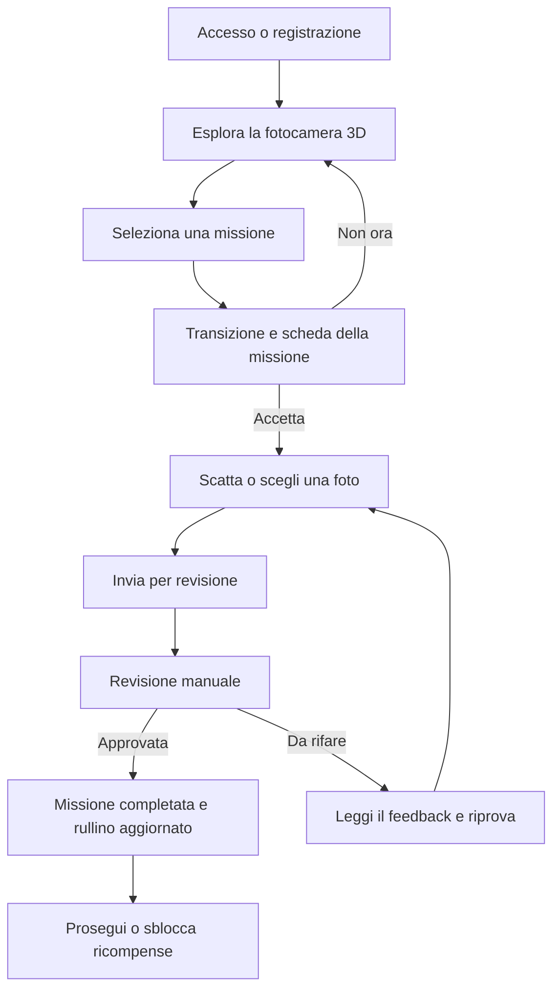

# Missioni Reflex


-3ECF8E?logo=supabase&logoColor=white)

**Missioni Reflex** è un prototipo di app mobile che unisce l'apprendimento della fotografia a un'esperienza di gioco. Al centro dell'interfaccia c'è una fotocamera analogica 3D ispirata alla Pentax K1000: le missioni compaiono attorno al modello e invitano l'utente a esplorare, scattare e imparare attraverso la pratica.

> **Stato del progetto:** MVP in sviluppo. Il flusso principale è stato provato su dispositivo mobile; l'esperienza e le prestazioni dei cosmetici 3D sono ancora in fase di rifinitura. Non è ancora una release pronta per la distribuzione pubblica.

## Indice

- [Obiettivo](#obiettivo)
- [Funzionalità](#funzionalità)
- [Come funziona una missione](#come-funziona-una-missione)
- [Percorso didattico](#percorso-didattico)
- [Tecnologie](#tecnologie)
- [Avvio del progetto](#avvio-del-progetto)
- [Modalità demo](#modalità-demo)
- [Configurare Supabase](#configurare-supabase)
- [Problemi noti e roadmap](#problemi-noti-e-roadmap)
- [Struttura del progetto](#struttura-del-progetto)
- [Crediti e licenze degli asset](#crediti-e-licenze-degli-asset)

## Obiettivo

L'idea è trasformare il mondo reale in un campo di esplorazione fotografica. L'utente non deve limitarsi a leggere lezioni o completare quiz: sceglie una missione, prova a realizzarla con la propria fotocamera e riceve una revisione che lo aiuta a migliorare.

La fotocamera 3D è il fulcro dell'esperienza: le missioni sono associate a punti della macchina, mentre il profilo e l'armadio permettono di seguire i progressi e personalizzare il modello.

## Funzionalità

- **Fotocamera 3D interattiva:** modello ruotabile con missioni selezionabili attorno alla macchina.
- **Transizione verso la missione:** quando si seleziona un'etichetta, la fotocamera si orienta e si avvicina al componente; la scheda della missione appare dopo la transizione.
- **Missioni fotografiche pratiche:** ogni missione propone un obiettivo, istruzioni, un suggerimento e criteri utili per la revisione.
- **Acquisizione o galleria:** dopo aver accettato una missione si può scattare una foto o selezionarne una dal dispositivo.
- **Revisione umana:** la foto inviata resta in attesa di un revisore. L'esito aggiorna lo stato della missione e può includere una nota.
- **Stati delle missioni:** disponibile, in corso, in revisione, completata oppure da rifare.
- **Rullino dei progressi:** le missioni approvate sviluppano i fotogrammi del rullino personale.
- **Armadio 3D:** un solo cosmetico può essere equipaggiato per volta; selezionarne un altro sostituisce il precedente.
- **Tutorial contestuali:** brevi suggerimenti alla prima visita delle aree principali, ricordati sul dispositivo.
- **Modalità demo locale** e integrazione opzionale con **Supabase** per account, invii e revisioni condivise.
- **Area amministratore:** coda degli invii con criteri di revisione per approvare una foto o richiederne una nuova.

## Come funziona una missione



## Percorso didattico

Le 12 missioni sono organizzate in tre capitoli da quattro missioni ciascuno:

| Capitolo | Obiettivo |
| --- | --- |
| **Composizione** | Imparare a scegliere il soggetto e organizzare gli elementi nell'inquadratura. |
| **Luce** | Osservare ombre, direzione della luce, controluce e qualità dell'illuminazione. |
| **Tecnica** | Esplorare messa a fuoco, movimento, profondità di campo ed esposizione. |

La progressione privilegia inizialmente composizione e luce, perché sono esercitabili con quasi qualsiasi telefono. Le missioni tecniche cercano di concentrarsi sugli effetti visibili anche quando il dispositivo non permette di regolare manualmente apertura, tempo o ISO.

Le missioni sono esercizi originali ispirati a concetti di base della fotografia. Per approfondire gli argomenti si possono consultare le risorse di [Cambridge in Colour](https://www.cambridgeincolour.com/tutorials.htm), tra cui i materiali su [esposizione](https://www.cambridgeincolour.com/tutorials/camera-exposure.htm) e [tecniche fotografiche](https://www.cambridgeincolour.com/photography-techniques.htm).

## Tecnologie

- **Android:** contenitore nativo dell'app, con `MainActivity` in Java.
- **HTML, CSS e JavaScript:** interfaccia e logica dell'esperienza.
- **Three.js:** rendering 3D, animazioni e interazione con il modello.
- **GLTFLoader / OrbitControls:** caricamento dei modelli GLB e controllo della visuale.
- **Gradle / Android Gradle Plugin:** compilazione Android.
- **Supabase (opzionale):** autenticazione, database, storage privato delle fotografie e policy RLS.

## Avvio del progetto

### Requisiti

- Android Studio.
- JDK 17.
- Android SDK Platform 36.
- Connessione Internet per sincronizzare le dipendenze Gradle e, in modalità Supabase, per usare il backend.

### Eseguire su Android

1. Clona o scarica il repository.
2. Apri in Android Studio la cartella `MissioniReflexAndroid`.
3. Attendi la sincronizzazione di Gradle e verifica che JDK 17 e Android SDK 36 siano selezionati.
4. Avvia l'app su un dispositivo Android o su un emulatore.

Per creare un APK debug dalla cartella `MissioniReflexAndroid`:

**Windows**

```bat
gradlew.bat assembleDebug
```

**macOS / Linux**

```bash
./gradlew assembleDebug
```

L'APK debug viene generato normalmente in `app/build/outputs/apk/debug/app-debug.apk`.

### Anteprima web con Visual Studio Code

I file web si trovano in `app/src/main/assets/www/`. Per provarli nel browser si può usare un'estensione come **Live Server** e aprire `index.html` tramite un indirizzo `http://localhost:...`.

**Non aprire direttamente `index.html` con un URL `file://`.** Il browser assegna alla pagina un'origine `null` e può bloccare il caricamento dei modelli GLB per motivi CORS. Avviare un server locale risolve questo specifico problema di origine.

## Modalità demo

La configurazione iniziale si trova in:

`app/src/main/assets/www/supabase-config.js`

Per impostazione predefinita `demoMode` è `true`. In questa modalità account di prova, progressi, accessori equipaggiati e invii sono memorizzati localmente nel WebView/dispositivo. La coda delle revisioni non viene condivisa tra dispositivi.

La modalità demo serve solo per testare l'esperienza. Non è un sistema di autenticazione adatto alla produzione: il codice demo dell'amministratore e la gestione locale degli account non devono essere considerati sicuri per un rilascio pubblico.

## Configurare Supabase

Per condividere account, fotografie e revisioni fra più dispositivi:

1. Crea un progetto Supabase.
2. Apri `supabase-schema.sql` nell'editor SQL del progetto ed eseguilo con un ruolo amministrativo. Lo schema crea le tabelle, le policy RLS e il bucket privato `mission-photos`; include anche il supporto alle 12 missioni.
3. Apri `app/src/main/assets/www/supabase-config.js` e inserisci l'URL del progetto e la chiave `anon`/publishable.
4. Imposta `demoMode: false`.
5. Crea un account nell'app e assegna il ruolo amministratore al profilo corretto tramite il pannello SQL di Supabase.

Esempio di configurazione:

```js
window.HPHOTO_CONFIG = {
  demoMode: false,
  supabaseUrl: "https://TUO-PROGETTO.supabase.co",
  supabaseAnonKey: "LA-TUA-CHIAVE-ANON-O-PUBLISHABLE",
  demoAdminCode: ""
};
```

**Sicurezza:** non inserire mai una chiave `service_role` nel codice client, nell'app Android o nel repository. Le chiavi pubbliche possono essere usate dal client solo insieme a policy RLS configurate correttamente. Prima di distribuire l'app, verifica tutte le policy e i permessi del progetto Supabase.

## Problemi noti e roadmap

### Rallentamenti quando si cambia cosmetico 3D

**Problema noto:** durante il cambio di cappello, sciarpa o moka è stato osservato un rallentamento significativo. Per questo motivo i cosmetici sono ancora una parte sperimentale dell'MVP e le loro prestazioni non sono considerate definitive.

I tre file GLB inclusi occupano complessivamente circa 22 MB. La dimensione degli asset può contribuire al problema, ma la causa esatta **non è stata ancora individuata tramite profiling**: il lag potrebbe dipendere dal caricamento/parsing dei modelli, dalla preparazione delle geometrie e dei materiali o dal lavoro richiesto alla GPU.

Interventi da valutare:

- profilare il cambio di accessorio su dispositivi Android reali;
- caricare ogni modello una sola volta e riutilizzare template/istanze invece di ripetere il parsing;
- verificare clonazione, materiali e rilascio delle risorse WebGL non più utilizzate;
- ridurre poligoni e dimensioni delle texture dove possibile;
- valutare compressione degli asset e caricamento anticipato con indicatore di attesa;
- misurare il tempo di cambio accessorio prima e dopo ogni ottimizzazione.

### Altri aspetti da rifinire

- Verificare su più dispositivi il posizionamento estetico di cappello e sciarpa e la scala della moka accanto alla fotocamera.
- Provare la compilazione debug e il flusso completo di autenticazione/invio/revisione nell'ambiente di sviluppo che clona il repository.
- Testare la rubrica di revisione con più persone: i criteri aiutano a rendere il giudizio più coerente, ma non sostituiscono il giudizio fotografico.
- Rifinire l'esperienza dopo aver raccolto feedback da persone che non conoscono il progetto.

## Struttura del progetto

```text
MissioniReflexAndroid/
├── app/
│   ├── src/main/
│   │   ├── java/it/missionireflex/app/   # wrapper Android nativo
│   │   ├── res/                         # risorse Android
│   │   ├── assets/www/
│   │   │   ├── index.html               # interfaccia e scena 3D
│   │   │   ├── mvp.js                   # missioni, account, invii e armadio
│   │   │   ├── supabase-config.js       # configurazione demo/backend
│   │   │   ├── lib/                     # Three.js, loader e controlli
│   │   │   └── models/cosmetics/        # modelli GLB cosmetici
│   └── build.gradle
├── gradle/wrapper/
├── supabase-schema.sql
├── build.gradle
├── settings.gradle
└── README.md
```

## Crediti e licenze degli asset

I modelli 3D di terze parti mantengono le licenze dei rispettivi autori. Per gli asset rilasciati sotto **Creative Commons Attribution 4.0 International (CC BY 4.0)**, occorre conservare l'attribuzione, collegare la licenza e indicare le modifiche apportate. Testo della licenza: [CC BY 4.0](https://creativecommons.org/licenses/by/4.0/).

- **Fotocamera 3D — “ASAHI PENTAX K1000”**: modello di **LOOWIE**, pubblicato su Sketchfab con licenza **CC BY 4.0**. Fonte: [pagina del modello su Sketchfab](https://sketchfab.com/3d-models/asahi-pentax-k1000-0e342ea75d9745fdb213658856d69dab).
- **Sciarpa — “Scarf Soccer - TF2”**: modello di **iron** (`ironmenleader`), pubblicato su Sketchfab con licenza **CC BY 4.0**. Fonte: [pagina del modello su Sketchfab](https://sketchfab.com/3d-models/scarf-soccer-tf2-685f62fbbfa449fb80cc2b9066a43743). Nel progetto la scala, l'orientamento e la posizione in scena sono adattati per utilizzarlo come cosmetico della fotocamera.
- **Moka — “Moka Pot”**: modello di **Kuba Wójcik** (`KWojcik`), pubblicato su Sketchfab con licenza **CC BY 4.0**. Fonte: [pagina del modello su Sketchfab](https://sketchfab.com/3d-models/moka-pot-963c5f8b81c045fcab90387bf3aa5143). Nel progetto la scala e la posizione in scena sono adattate per mostrarlo accanto alla fotocamera.
- **Cappello — `HatModificato.glb`**: il file GLB disponibile nel progetto non conserva metadati sufficienti a identificare con certezza autore, fonte originale e licenza. **La licenza del cappello è quindi da verificare**: prima di distribuire pubblicamente questo asset, aggiungere la fonte originale e la licenza applicabile oppure sostituirlo con un modello dalla provenienza verificabile. Non attribuire a questo modello una licenza presunta.

**Marchio Pentax:** Pentax è un marchio di Ricoh Imaging Company, Ltd. Missioni Reflex è un progetto indipendente, non affiliato né approvato dal titolare del marchio.

**Licenza del progetto:** questi crediti non concedono automaticamente una licenza su tutto il repository. Finché non viene aggiunto un file `LICENSE`, non presumere che codice e contenuti originali di Missioni Reflex siano liberamente riutilizzabili. Le licenze degli asset di terze parti continuano ad applicarsi separatamente.

---

*Missioni Reflex è un progetto personale in evoluzione. Suggerimenti e segnalazioni sui problemi sono benvenuti; la priorità attuale è rendere fluide le interazioni 3D e validare l'esperienza didattica con utenti reali.*
